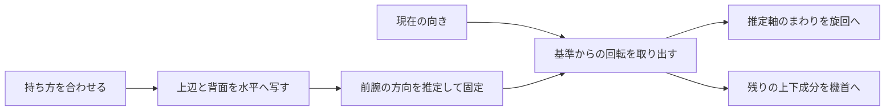

# v0.1.36 手首方式

スマホは腕の向きを直接測れないため、構えた姿勢から水平な前腕の向きを推定する。これを第3の比較方式として追加し、初期値と保存済みの選択を保つ。公開・実機の状況は [検証記録](verification-v0136.md) に分ける。

センサーの座標では上がZ、描画では上がYなので、画面側の軸をそのまま使わない。基準の上辺・背面をセンサーの水平面へ写し、それぞれの向きを足して軸Aを作る。片方がほぼ垂直なら他方、互いに打ち消し合う場合は長い方を使う。同じ長さなら背面を選ぶ。この軸は合わせ直すまで固定する。

基準と現在の向きをQref/Qcurとすると、差Qは `Qcur × inverse(Qref)`。向きを表す4成分Q=(vx,vy,vz,w)の最初の3成分をvとし、軸Aまわりの角度を `2 × atan2(v・A, w)` で取り出す。残りの回転から上下を取り出すため、手首だけを回したときの機首への混ざりを抑える。旧2方式の計算と、固定表示に渡す従来の画面の回し角度は変更しない。

初期は中立3°・最大25°、範囲は0〜8°と5〜40°。中立は最大より1°以上小さくする。共通の効き方のカーブは1回だけ適用する。通常と高速空域の両方へ接続し、探索は従来の入力を使う。

手首用の感度は、ボタンを押したときだけ30°/25°/18°へ変更する。従来の感度まとめ設定は現行アプリに存在しなかったため、旧2方式の数値へまとめ変更しない小さい追加とした。変更前の値を保存し、同値では履歴を増やさない。

## 保存・記録

有効なURL > 本人が選んで保存した方式 > 従来の初期tiltの順。読込だけでは保存しない。同じ方式のボタンでも、本人が明示的に押したときは保存する。新しいPWAの起動URLは `steer=tilt` の固定指定を外し、保存した方式を使う。未設定の初期値はtiltのまま。旧ホーム画面アイコンの更新反映は実機確認へ残す。

記録とコピーへ、選択方式・基準の角度・推定軸・実センサー/仮想入力の区別・合わせ直すごとの角度の幅を加える。探索の揺れ幅には従来の左右入力を使い、通常/高速で手首を選んだ場合だけ手首角度を使う。

画面の向きが変わった際の停止は、現行ではiPhoneだけに適用される。Android/PCではそのまま操作を続け、基準も勝手に合わせ直さない。持ち方を変えた場合は本人の「持ち方を合わせ直す」を使う。この端末別の条件を全端末共通の停止へ変更しない。

## 残る条件

独立した上下・体の左右向きは分離できるが、同時に異なる軸で回す順番によって混ざりは残る。30°の左右向きと15°の上下を組み合わせる試験では約4.04°の混ざりを確認した。この差を0扱いせず、回転の順番から求めた式と照合する。180°付近の角度の折り返しと、軸を分けられない瞬間も残る。その瞬間は直前の有限な操作を保ち、自動で一時停止や画面操作へ切り替えない。

これは作った向きでの計算とPCの疑似入力での確認であり、実際の腕・端末の癖や使いやすさを確定するものではない。

追加検査で見つけた旧開始画面のはみ出しは、開始2操作を横並びにして修正した。3つの旋回方式は44px以上の操作面を保ち、通常のタイトル・プレイ画面の配置は変えない。

地図演出では、完了時刻をまたぐ2回の読取りの間に最後の更新が抜ける条件を修正した。同じ進行値で表示と次の描画を判断し、画面を隠して戻った際も完了表示を更新する。演出は引き続き可視時間3.6秒で、座標や飛行時計・音の処理は変えない。
